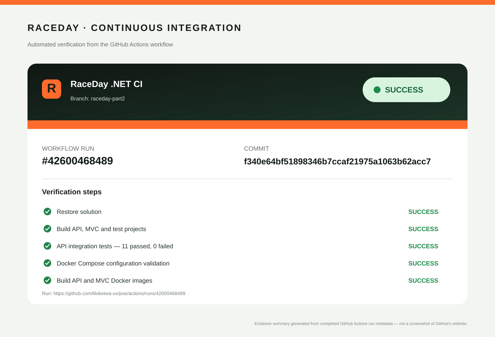

# RaceDay — Event Management Platform

RaceDay is a South African road-running, walking and cycling event platform. Organisers publish events, manage categories, review enrolments and capture race results. Participants discover events, enrol and view their personal results.

**Technology:** C#, ASP.NET Core Web API, ASP.NET Core MVC, Entity Framework Core, SQL Server, Swagger, xUnit, Azure Blob Storage and Docker.

## Repository map

| Part | Location | Deliverables |
|---|---|---|
| Part 1 — Planning/database | `docs/` | ERD, endpoint plan, SQL Server schema |
| Part 2 — REST API | `Part_2_Submission/` | ASP.NET Core API, EF Core, cookie/session authentication, role access, Swagger, tests |
| Part 3 — MVC | `Part_3_Submission/` | MVC front end, API client, role-specific UI, Azure upload forwarding, Docker |
| CI/CD | `.github/workflows/raceday-ci.yml` | Builds all projects and runs API integration tests |

The previous CampusConnect HTML/JavaScript prototype was not the required application and has been removed from the corrected Part 2 submission.

## Part 1

The Part 1 RaceDay planning artefacts remain in `docs/`: ERD, API endpoint plan and SQL Server schema.

## Part 2 — RESTful API development

The API is written in C# and uses EF Core Code-First with SQL Server. It provides Organiser and Participant roles, Identity password hashing, an HTTP-only authentication cookie and session state, role-protected endpoints and Swagger documentation.

See [Part 2 README](Part_2_Submission/README.md).

## Part 3 — MVC application

The MVC application consumes Part 2 through a typed server-side HTTP client. It has no direct database access. It provides public event discovery, Organiser and Participant dashboards, event and category management, enrolments, results and profile pages. Event banners and profile photos are sent through the API to Azure Blob Storage.

See [Part 3 README](Part_3_Submission/README.md).

## Build and test

Requires the .NET 10 SDK. From the repository root:

```powershell
dotnet restore RaceDay.sln
dotnet build RaceDay.sln --configuration Release
dotnet test Part_2_Submission/RaceDay.Api.Tests/RaceDay.Api.Tests.csproj --configuration Release
```

The same build and test steps run in GitHub Actions for pushes to `main` and `raceday-*` branches and for pull requests to `main`.

## Docker

From `Part_3_Submission/`, set `SA_PASSWORD` and run `docker compose up --build`. See the Part 3 README for the full instructions and optional Azure configuration.

## Verified CI/CD



The linked GitHub Actions run completed successfully on 9 November 2026: solution restore/build, 11 API integration tests, Docker Compose validation, API image build and MVC image build all passed. [Open the full run on GitHub](https://github.com/liloketwa-ux/poe/actions/runs/42599939947). The SVG is a generated evidence summary from the run metadata, not a screenshot of the GitHub website.
- The POE includes UI design previews with sample data. Replace/add genuine screenshots after running the MVC application locally or in Docker.
- Replace the YouTube placeholders in Part 2 and Part 3 READMEs with your unlisted demonstration link.
- The assignment requires at least 20 meaningful commits for each of Parts 2 and 3. Review the actual history and ensure each commit represents work you completed and understand.
